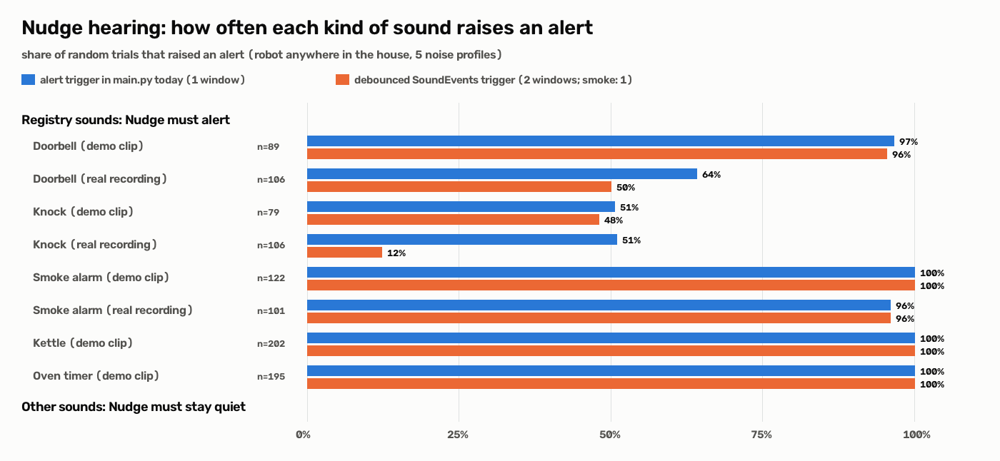

# Hearing evaluation: right sounds in, everything else out

Generated by `pixi run hearing-eval --n 1000 --seed 0` (1000 random trials, 73 s on CPU, backend `YAMNet-TFLite+spectral`, env NUDGE_REAL_AUDIO=1, NUDGE_SMOKE_TONAL=(default = NUDGE_REAL_AUDIO)).

Each trial: a random clip, a random robot pose anywhere on the ground floor, one of the 5 background-noise profiles; the clip goes through the sim's ear model (distance + wall attenuation, ILD/ITD, noise, AGC) and every 0.5 s window through `hearing.process_audio`, as in the running robot. **Alert** = what `main.py` acts on: smoke score >= 0.6 (safety pre-emption) or a non-danger registry sound as the top label with confidence >= 0.5. Registry sounds ring for 10 s at their installed spot; ESC-50 clips play once (5 s) at a random spot in a random room, 0.5-2x loudness. Dataset: **ESC-50** (K. J. Piczak, CC BY-NC 3.0, 2,000 clips, 50 classes; downloaded by `pixi run fetch-esc50`, not in git). Real registry recordings: Wikimedia Commons (CC0 / public domain, see README).



## Headline

| | result |
|---|---|
| (a) Registry sounds, demo clips (synthesized): alerted | **94 %** (645/687) |
| (a) Registry sounds, all clips incl. real recordings | 86 % (864/1000) |
| (b) Background noise only: false alert | **-** (0/0) |
| (b) Other real-world sounds (ESC-50): false alert | **-** (0/0) |
| (b) same, with the 2-window debounce of `SoundEvents` | - (0/0); registry demo clips then detected 93 % |
| (b) of which a false smoke alert (= false evacuation) | - (0/0) |
| (b) Registry trials: alert for the wrong sound | 7.2 % (72/1000) |
| (c) Smoke alarm missed, demo clip | **0 %** (0/122) |
| (c) Smoke alarm missed, all clips | 1.8 % (4/223) |

## (a) Registry sounds: detection rate and time to alert

| sound | clip | trials | alerted | median time to alert | slowest | SoundEvents start |
|---|---|---|---|---|---|---|
| Doorbell | synthesized (demo) | 89 | 97 % | 0.5 s | 1.0 s | 96 % |
| Doorbell | real (Wikimedia) | 106 | 64 % | 0.8 s | 10.0 s | 50 % |
| Knock | synthesized (demo) | 79 | 51 % | 0.5 s | 5.0 s | 48 % |
| Knock | real (Wikimedia) | 106 | 51 % | 1.0 s | 9.0 s | 12 % |
| Smoke alarm | synthesized (demo) | 122 | 100 % | 0.5 s | 0.5 s | 100 % |
| Smoke alarm | real (Wikimedia) | 101 | 96 % | 0.5 s | 1.0 s | 96 % |
| Kettle | synthesized (demo) | 202 | 100 % | 0.5 s | 0.5 s | 100 % |
| Oven timer | synthesized (demo) | 195 | 100 % | 0.5 s | 0.5 s | 100 % |

By noise profile (all registry trials, alerted / trials):

| sound | quiet | fan | tv | vacuum | party |
|---|---|---|---|---|---|
| Doorbell (demo) | 19/19 | 22/22 | 21/21 | 12/15 | 12/12 |
| Doorbell (real) | 22/22 | 21/21 | 6/18 | 11/26 | 8/19 |
| Knock (demo) | 11/11 | 18/18 | 4/17 | 4/15 | 3/18 |
| Knock (real) | 28/28 | 18/23 | 0/26 | 8/17 | 0/12 |
| Smoke alarm (demo) | 24/24 | 33/33 | 29/29 | 19/19 | 17/17 |
| Smoke alarm (real) | 16/16 | 17/17 | 23/23 | 22/23 | 19/22 |
| Kettle (demo) | 43/43 | 39/39 | 42/42 | 37/37 | 41/41 |
| Oven timer (demo) | 38/38 | 29/29 | 45/45 | 46/46 | 37/37 |

## (b) Everything else: false alerts

0 sound classes, 0 trials. Classes that triggered an alert:

**None.**

No alert (0 classes): .

`SoundEvents` (taught-task trigger) false starts on these trials: 0/0.

Registry trials that also alerted for another sound: smoke_alarm (real, vacuum) -> kettle, smoke_alarm (real, vacuum) -> kettle, smoke_alarm (real, tv) -> kettle, smoke_alarm (real, tv) -> kettle, smoke_alarm (real, quiet) -> kettle, smoke_alarm (real, party) -> kettle, smoke_alarm (real, vacuum) -> kettle, knock (synth, party) -> kettle, smoke_alarm (real, vacuum) -> kettle, smoke_alarm (real, tv) -> kettle, smoke_alarm (real, party) -> kettle, smoke_alarm (real, tv) -> kettle.

## (c) Smoke alarm (safety-critical)

- **Demo clip (synthesized 3.15 kHz)**: missed 0/122 (0 %); pre-emption after median 0.5 s, at most 0.5 s.
- **Real recording (2.8 kHz)**: missed 4/101 (4.0 %); pre-emption after median 0.5 s, at most 1.0 s. Missed in: robot in family_room, party noise (max score 0.08); robot in guest, vacuum noise (max score 0.09); robot in guest, party noise (max score 0.07); robot in entry, party noise (max score 0.08)

## Confusion table (trials -> what Nudge alerted)

| played \ alerted | doorbell | knock | smoke_alarm | kettle | oven_timer | no alert |
|---|---|---|---|---|---|---|
| Doorbell (n=195) | 154 | . | . | . | . | 41 |
| Knock (n=185) | 1 | 94 | . | 3 | . | 88 |
| Smoke alarm (n=223) | . | . | 219 | 68 | . | 4 |
| Kettle (n=202) | . | . | . | 202 | . | . |
| Oven timer (n=195) | . | . | . | . | 195 | . |

(A trial can alert more than one sound, so a row can add up to more than n.)

## Reproduce

```bash
pixi run fetch-esc50
pixi run hearing-eval --n 1000 --seed 0
```

Per-trial rows: `assets/eval/hearing_trials.csv` (gitignored).
