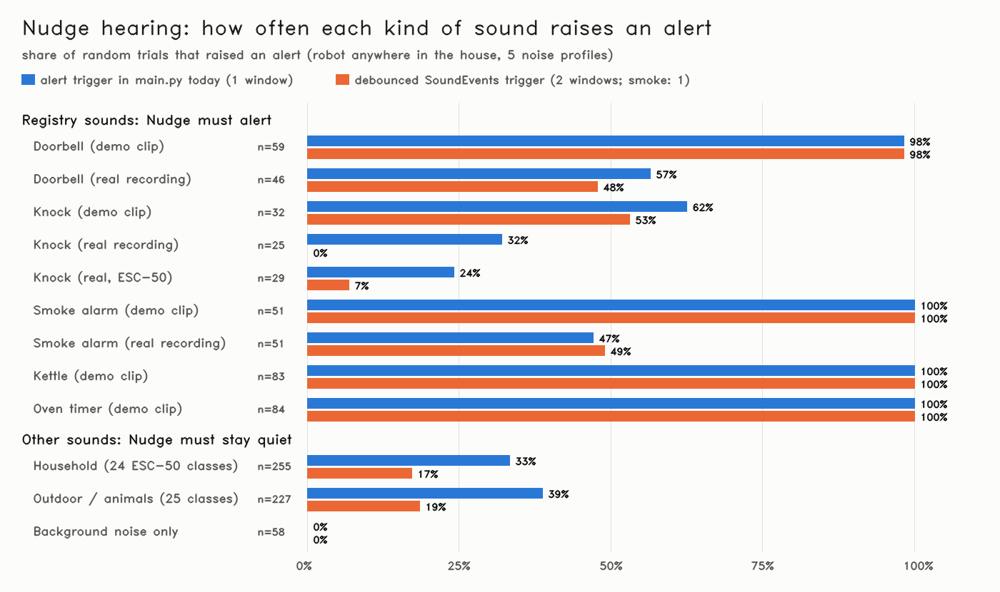

# Hearing evaluation: right sounds in, everything else out

Generated by `pixi run hearing-eval --n 1000 --seed 0` (1000 random trials, 439 s on CPU, backend `YAMNet-TFLite+spectral`, env NUDGE_REAL_AUDIO=0, NUDGE_SMOKE_TONAL=(default = NUDGE_REAL_AUDIO)).

Each trial: a random clip, a random robot pose anywhere on the ground floor, one of the 5 background-noise profiles; the clip goes through the sim's ear model (distance + wall attenuation, ILD/ITD, noise, AGC) and every 0.5 s window through `hearing.process_audio`, as in the running robot. **Alert** = what `main.py` acts on: smoke score >= 0.6 (safety pre-emption) or a non-danger registry sound as the top label with confidence >= 0.5. Registry sounds ring for 10 s at their installed spot; ESC-50 clips play once (5 s) at a random spot in a random room, 0.5-2x loudness. Dataset: **ESC-50** (K. J. Piczak, CC BY-NC 3.0, 2,000 clips, 50 classes; downloaded by `pixi run fetch-esc50`, not in git). Real registry recordings: Wikimedia Commons (CC0 / public domain, see README).



## Headline

| | result |
|---|---|
| (a) Registry sounds, demo clips (synthesized): alerted | **96 %** (296/309) |
| (a) Registry sounds, all clips incl. real recordings | 78 % (361/460) |
| (b) Background noise only: false alert | **0 %** (0/58) |
| (b) Other real-world sounds (ESC-50): false alert | **36 %** (173/482) |
| (b) same, with the 2-window debounce of `SoundEvents` | 18 % (86/482); registry demo clips then detected 95 % |
| (b) of which a false smoke alert (= false evacuation) | 1.5 % (7/482) |
| (b) Registry trials: alert for the wrong sound | 8.7 % (40/460) |
| (c) Smoke alarm missed, demo clip | **0 %** (0/51) |
| (c) Smoke alarm missed, all clips | 26 % (27/102) |
| (d) YAMNet top-1 on 2,000 clean ESC-50 clips (50 classes) | **40 %** (top-3 71 %) |

## (a) Registry sounds: detection rate and time to alert

| sound | clip | trials | alerted | median time to alert | slowest | SoundEvents start |
|---|---|---|---|---|---|---|
| Doorbell | synthesized (demo) | 59 | 98 % | 0.5 s | 1.5 s | 98 % |
| Doorbell | real (Wikimedia) | 46 | 57 % | 0.5 s | 4.5 s | 48 % |
| Knock | synthesized (demo) | 32 | 62 % | 0.5 s | 4.0 s | 53 % |
| Knock | real (Wikimedia) | 25 | 32 % | 0.8 s | 2.0 s | 0 % |
| Knock | real (ESC-50 knocks) | 29 | 24 % | 1.0 s | 2.0 s | 6.9 % |
| Smoke alarm | synthesized (demo) | 51 | 100 % | 0.5 s | 0.5 s | 100 % |
| Smoke alarm | real (Wikimedia) | 51 | 47 % | 2.0 s | 10.0 s | 49 % |
| Kettle | synthesized (demo) | 83 | 100 % | 0.5 s | 0.5 s | 100 % |
| Oven timer | synthesized (demo) | 84 | 100 % | 0.5 s | 0.5 s | 100 % |

By noise profile (all registry trials, alerted / trials):

| sound | quiet | fan | tv | vacuum | party |
|---|---|---|---|---|---|
| Doorbell (demo) | 13/13 | 14/14 | 12/12 | 5/6 | 14/14 |
| Doorbell (real) | 8/8 | 9/9 | 3/6 | 1/10 | 5/13 |
| Knock (demo) | 8/8 | 9/9 | 1/5 | 0/5 | 2/5 |
| Knock (real) | 4/8 | 9/11 | 0/18 | 2/10 | 0/7 |
| Smoke alarm (demo) | 11/11 | 10/10 | 9/9 | 8/8 | 13/13 |
| Smoke alarm (real) | 7/7 | 5/7 | 10/14 | 2/15 | 0/8 |
| Kettle (demo) | 17/17 | 21/21 | 16/16 | 12/12 | 17/17 |
| Oven timer (demo) | 18/18 | 17/17 | 16/16 | 13/13 | 20/20 |

## (b) Everything else: false alerts

50 sound classes, 540 trials. Classes that triggered an alert:

| sound | trials | false alerts | alerted as | noise of the false ones |
|---|---|---|---|---|
| airplane | 8 | 2 | doorbell, kettle | quiet |
| breathing | 13 | 6 | doorbell, kettle, oven_timer | fan, quiet |
| brushing_teeth | 12 | 3 | doorbell, kettle, knock | quiet |
| can_opening | 7 | 1 | kettle, smoke_alarm | quiet |
| car_horn | 14 | 6 | doorbell, kettle, oven_timer | fan, party, quiet, tv |
| cat | 8 | 2 | doorbell, kettle | fan |
| chirping_birds | 10 | 7 | kettle, oven_timer, smoke_alarm | fan, party, quiet, vacuum |
| church_bells | 10 | 5 | doorbell, kettle, oven_timer | party, quiet, tv |
| clapping | 12 | 1 | doorbell | tv |
| clock_tick | 11 | 1 | kettle | fan |
| coughing | 12 | 4 | doorbell, knock | fan, quiet |
| cow | 13 | 7 | doorbell, kettle, knock | quiet, tv |
| crickets | 10 | 3 | kettle, smoke_alarm | fan, party, quiet |
| crow | 11 | 4 | doorbell, kettle | fan, quiet, tv |
| crying_baby | 14 | 8 | doorbell, kettle, oven_timer, smoke_alarm | fan, party, tv |
| dog | 11 | 6 | doorbell | fan, quiet, tv |
| door_wood_creaks | 14 | 8 | doorbell, kettle | fan, quiet |
| drinking_sipping | 8 | 2 | kettle, knock | quiet |
| engine | 11 | 3 | doorbell, kettle, knock | fan, quiet |
| fireworks | 10 | 4 | doorbell, knock | fan, party, quiet |
| footsteps | 10 | 1 | knock | quiet |
| frog | 5 | 4 | kettle | fan, quiet, tv, vacuum |
| glass_breaking | 12 | 2 | oven_timer | fan, tv |
| hand_saw | 5 | 2 | doorbell, knock | fan, quiet |
| hen | 12 | 9 | doorbell, kettle | fan, quiet, tv |
| insects | 8 | 2 | doorbell, oven_timer | fan, party |
| keyboard_typing | 5 | 1 | knock | vacuum |
| laughing | 10 | 6 | doorbell, kettle, knock | fan, quiet, tv |
| mouse_click | 12 | 1 | kettle | quiet |
| pig | 9 | 5 | doorbell, knock, smoke_alarm | quiet, tv, vacuum |
| pouring_water | 18 | 6 | doorbell, kettle, knock | fan, quiet, tv, vacuum |
| rain | 7 | 1 | doorbell, knock | quiet |
| rooster | 16 | 8 | doorbell, kettle, oven_timer | fan, party, quiet |
| sea_waves | 9 | 2 | knock | quiet |
| sheep | 6 | 4 | doorbell, kettle | fan, quiet, vacuum |
| siren | 5 | 2 | doorbell, kettle | party, quiet |
| sneezing | 13 | 6 | doorbell, knock, smoke_alarm | party, quiet, tv |
| snoring | 14 | 8 | doorbell, kettle, knock | fan, quiet |
| thunderstorm | 14 | 7 | knock | fan, party, quiet, tv |
| toilet_flush | 7 | 3 | kettle, knock | fan, quiet |
| vacuum_cleaner | 4 | 2 | doorbell, kettle | fan, tv |
| washing_machine | 12 | 3 | doorbell, kettle, knock, oven_timer | party, quiet, tv |
| water_drops | 10 | 4 | knock, oven_timer | party, quiet, tv |
| wind | 11 | 1 | doorbell | tv |

Which detector fired the false alerts (trials; a trial can count for both): spectral 172, yamnet 2.

No alert (6 classes): background only, chainsaw, clock_alarm, crackling_fire, helicopter, train.

`SoundEvents` (taught-task trigger) false starts on these trials: 86/540: siren -> kettle, door_wood_creaks -> kettle, drinking_sipping -> knock, breathing -> kettle, pouring_water -> doorbell, airplane -> doorbell, washing_machine -> doorbell/oven_timer, vacuum_cleaner -> kettle, laughing -> doorbell, coughing -> knock, breathing -> doorbell, cow -> doorbell.

Registry trials that also alerted for another sound: doorbell (synth, party) -> kettle, knock (real-esc50, fan) -> doorbell, smoke_alarm (real, tv) -> kettle, smoke_alarm (real, fan) -> kettle, smoke_alarm (real, vacuum) -> kettle, smoke_alarm (real, tv) -> kettle, smoke_alarm (real, party) -> kettle, smoke_alarm (real, vacuum) -> kettle, smoke_alarm (real, vacuum) -> kettle, smoke_alarm (real, fan) -> kettle, smoke_alarm (real, vacuum) -> kettle, smoke_alarm (real, tv) -> kettle.

## (c) Smoke alarm (safety-critical)

- **Demo clip (synthesized 3.15 kHz)**: missed 0/51 (0 %); pre-emption after median 0.5 s, at most 0.5 s.
- **Real recording (2.8 kHz)**: missed 27/51 (53 %); pre-emption after median 2.0 s, at most 10.0 s. Missed in: robot in lobby0, party noise (max score 0.09); robot in dining, party noise (max score 0.08); robot in kitchen, vacuum noise (max score 0.33); robot in garden_room, party noise (max score 0.07); robot in guest, vacuum noise (max score 0.09); robot in dining, vacuum noise (max score 0.09); robot in entry, party noise (max score 0.08); robot in laundry, vacuum noise (max score 0.09)

## (d) YAMNet recognises far more than our 5 sounds

YAMNet (521 AudioSet classes) on every clean ESC-50 clip, scores averaged over the clip. A hit = the top class is one of the AudioSet classes mapped to that ESC-50 class (incl. its direct parent; mapping in `scripts/test_hearing_eval.py`). Household classes first.

| ESC-50 class | top-1 | top-3 | YAMNet's most common answer |
|---|---|---|---|
| keyboard_typing (household) | 100 % | 100 % | Typing (40/40) |
| toilet_flush (household) | 98 % | 98 % | Toilet flush (39/40) |
| crying_baby (household) | 82 % | 92 % | Crying, sobbing (33/40) |
| clock_alarm (household) | 78 % | 98 % | Alarm clock (22/40) |
| clapping (household) | 68 % | 95 % | Applause (18/40) |
| pouring_water (household) | 68 % | 100 % | Liquid (16/40) |
| breathing (household) | 48 % | 85 % | Silence (11/40) |
| snoring (household) | 48 % | 98 % | Breathing (20/40) |
| vacuum_cleaner (household) | 48 % | 52 % | Vacuum cleaner (19/40) |
| footsteps (household) | 45 % | 60 % | Walk, footsteps (17/40) |
| coughing (household) | 40 % | 88 % | Silence (22/40) |
| laughing (household) | 28 % | 78 % | Speech (19/40) |
| cat (household) | 25 % | 70 % | Animal (14/40) |
| door_wood_knock (household) | 25 % | 80 % | Silence (25/40) |
| clock_tick (household) | 22 % | 42 % | Clock (9/40) |
| glass_breaking (household) | 20 % | 82 % | Silence (31/40) |
| water_drops (household) | 20 % | 42 % | Silence (12/40) |
| dog (household) | 12 % | 88 % | Animal (26/40) |
| drinking_sipping (household) | 12 % | 18 % | Silence (15/40) |
| sneezing (household) | 12 % | 85 % | Silence (33/40) |
| brushing_teeth (household) | 10 % | 22 % | Rub (14/40) |
| can_opening (household) | 0 % | 0 % | Silence (27/40) |
| door_wood_creaks (household) | 0 % | 7.5 % | Silence (10/40) |
| mouse_click (household) | 0 % | 0 % | Silence (15/40) |
| washing_machine (household) | 0 % | 2.5 % | Vehicle (24/40) |
| church_bells | 95 % | 100 % | Bell (38/40) |
| fireworks | 95 % | 98 % | Explosion (20/40) |
| engine | 88 % | 100 % | Vehicle (25/40) |
| thunderstorm | 88 % | 98 % | Thunderstorm (35/40) |
| siren | 80 % | 98 % | Siren (21/40) |
| hand_saw | 68 % | 90 % | Sawing (20/40) |
| insects | 62 % | 72 % | Insect (22/40) |
| chainsaw | 60 % | 68 % | Chainsaw (24/40) |
| frog | 58 % | 92 % | Frog (23/40) |
| cow | 52 % | 88 % | Cattle, bovinae (20/40) |
| pig | 52 % | 80 % | Pig (21/40) |
| crow | 42 % | 78 % | Crow (17/40) |
| sheep | 38 % | 98 % | Sheep (15/40) |
| train | 38 % | 100 % | Vehicle (24/40) |
| chirping_birds | 30 % | 92 % | Animal (18/40) |
| sea_waves | 30 % | 82 % | Water (18/40) |
| rain | 28 % | 72 % | Water (19/40) |
| car_horn | 18 % | 50 % | Vehicle (19/40) |
| crackling_fire | 18 % | 52 % | Vehicle (13/40) |
| helicopter | 12 % | 62 % | Vehicle (32/40) |
| crickets | 10 % | 22 % | Wild animals (8/40) |
| hen | 10 % | 95 % | Animal (33/40) |
| rooster | 7.5 % | 92 % | Animal (26/40) |
| airplane | 2.5 % | 58 % | Vehicle (37/40) |
| wind | 0 % | 10 % | Vehicle (22/40) |

Household classes: top-1 36 %. Through the robot's ears (house acoustics + noise) the per-trial YAMNet top class is in `assets/eval/hearing_trials.csv`.

## Confusion table (trials -> what Nudge alerted)

| played \ alerted | doorbell | knock | smoke_alarm | kettle | oven_timer | no alert |
|---|---|---|---|---|---|---|
| Doorbell (n=105) | 84 | . | . | 1 | . | 21 |
| Knock (n=86) | 4 | 35 | . | 1 | . | 48 |
| Smoke alarm (n=102) | . | . | 75 | 34 | . | 11 |
| Kettle (n=83) | . | . | . | 83 | . | . |
| Oven timer (n=84) | . | . | . | . | 84 | . |
| other household sounds (n=255) | 41 | 24 | 3 | 32 | 9 | 170 |
| other outdoor / animal sounds (n=227) | 28 | 26 | 4 | 34 | 9 | 139 |
| background only (n=58) | . | . | . | . | . | 58 |

(A trial can alert more than one sound, so a row can add up to more than n.)

## Reproduce

```bash
pixi run fetch-esc50
pixi run hearing-eval --n 1000 --seed 0
```

Per-trial rows: `assets/eval/hearing_trials.csv` (gitignored).
